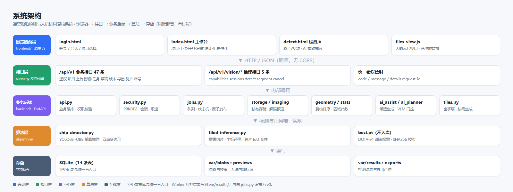
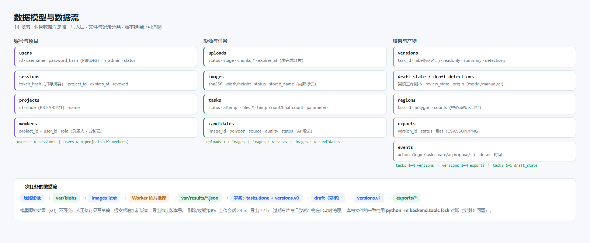
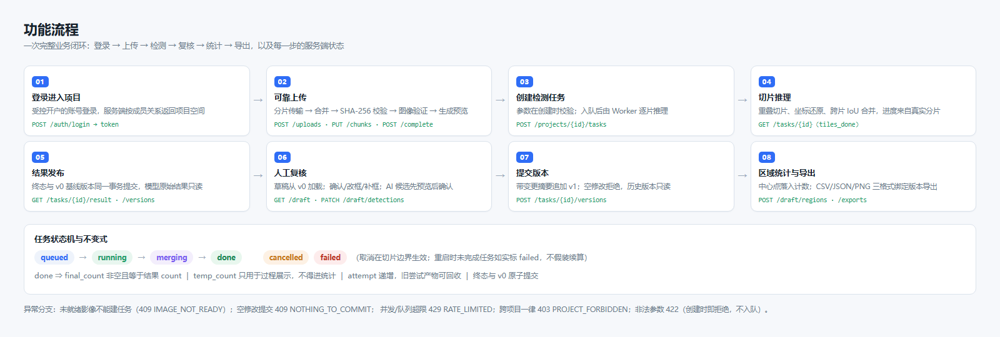

# 面向港口巡查的遥感影像船舶检测与人机协同复核系统

**—— 基于 AI 工具的小型应用开发 · 考查报告**

| 项 | 内容 |
|---|---|
| 课程 | 基于 AI 工具的小型应用开发 |
| 题目 | 面向港口巡查的遥感影像船舶检测与人机协同复核系统 |
| 姓名 | **陈燃** |
| 学号 | **2025132028** |
| 完成人 | A 方（算法与核心能力） |
| 协作方 | B 方（应用与业务功能） |
| 代码仓库 | https://github.com/roxysunrise/remote-sensing-ship-review |
| 提交基线 | `main` @ `96cf56d`；规格见根目录 [`SPEC.md`](../../SPEC.md) |
| 日期 | 2026-11-09 |

---

## 目录

- [一、需求分析](#一需求分析)
- [二、系统设计](#二系统设计)
- [三、详细设计与实现](#三详细设计与实现)
- [四、测试与结果分析](#四测试与结果分析)
- [五、AI 编程体会](#五ai-编程体会)
- [六、总结与展望](#六总结与展望)
- [附录](#附录)

---

## 一、需求分析

### 1.1 问题从哪来

港口巡查的遥感影像有三个现实特点，决定了人工看图不可行：

1. **幅面大**。一景影像动辄 2000×1500 像素以上，缩到屏幕上局部目标只剩几个像素；
2. **目标小且密**。船舶在港池里成排停靠，方向各异，密集处目标相互贴边；
3. **要留痕**。盘点结论要能追溯到"谁在哪一版改了什么"，不能只有一个截图。

把这三条翻译成工程需求，就是本系统的四个支柱：

| 现实约束 | 工程需求 | 落点 |
|---|---|---|
| 大图缩放丢目标 | 分区域处理 + 坐标还原 | 重叠切片推理、跨片 IoU 合并 |
| 目标密、方向任意 | 用旋转框而非水平框 | YOLOv8l-OBB，四点坐标 |
| 结果要可复核 | 模型结果不可变 + 人工修订追加版本 | v0 只读、v1 追加、导出绑定版本 |
| 要能追溯 | 操作与状态可查 | 事件表、任务状态机、版本摘要 |

### 1.2 用户与使用场景

使用者是**影像分析人员**，不是算法工程师。设定三个角色：

- **账号管理员**：开户、改密、停用账号；
- **项目负责人**：管项目成员，负责项目内全部操作；
- **项目分析员**：上传、建任务、复核、统计、导出。

典型场景：分析员拿到一景港口影像 → 上传（中途断网可续传）→ 建检测任务 → 在大图工作台上缩放定位 →
逐条确认/改框/补框（漏检的可以点选让 AI 出候选）→ 圈定关注区域看船舶数量 →
提交版本 → 导出 CSV/报告给上级。

### 1.3 功能范围与优先级

需求按"必须有 / 亮点 / 不做"三档切分：

| 档位 | 内容 |
|---|---|
| 必须有 | 登录与项目隔离、可恢复上传、影像管理、真实检测、大图浏览、真实进度、旋转框修订、区域统计、版本与导出、账号受控开户 |
| 亮点 | 大图渐进检测与瓦片视口、可解释的疑难复核（原因 + 排序）、可追溯版本与数据回流、AI 辅助标注 |
| 不做 | 连续视频流实时检测、公开注册、多租户计费、高可用集群、语义分割模型 |

明确"不做"和"必须做"同样重要——它让工作量可控，也让验收有边界。

### 1.4 验收标准怎么定

每条功能都必须能回答"凭什么说它成了"。我们的办法是**把验收写成可执行的脚本**，而不是截图：

| 验收对象 | 判据 | 形式 |
|---|---|---|
| 规格与实现一致 | 每条规格能在代码里找到实现、在测试里找到用例 | `SPEC.md` §3 的对照表 |
| 后端正确性 | 92 项单元/集成测试（含真实推理） | `python -m unittest discover -s tests` |
| 接口契约 | 真实响应通过 B 方 OpenAPI 的字段/类型/枚举校验 | `backend/tools/check_contract.py` |
| 端到端 | 登录→上传→检测→复核→统计→导出 全链路 | `scripts/e2e_link_check.py`（39 项） |
| 界面可用 | 真实浏览器点得动、无 JS 异常 | `scripts/app_flow_check.py`（13 项） |
| 数据一致性 | 库与文件对账 | `python -m backend.tools.fsck` |

这套判据后来直接支撑了 §4 的测试章节，也让"改了代码不重跑测试"这类问题无处藏。

---

## 二、系统设计

### 2.1 总体架构



系统是**单进程同源部署**：`scripts/serve.py` 同时提供前端静态文件与 `/api/v1` 反向代理，
浏览器与接口同源，因此前端零配置、不需要 CORS。分层与职责：

| 层 | 目录 | 职责 |
|---|---|---|
| 表现层 | `frontend/` | 登录页、工作台（9 个视图）、检测页、大图瓦片视口 |
| 接口层 | `backend/api.py`、`backend/vision.py` | 52 条路由、统一错误信封、逐请求权限校验 |
| 业务层 | `backend/*.py` | 任务运行时、存储、几何、统计、AI 候选、瓦片 |
| 算法层 | `algorithm/` | YOLOv8l-OBB 单图推理 + 重叠切片与合并 |
| 存储层 | SQLite + `var/` | 14 张表 + 私有文件目录 |

**关键边界**：业务数据库是唯一写入口。Worker 只把检测结果写到 `var/results/`，
再由 `jobs.py` 在一个事务里发布"任务终态 + v0 版本"，计算侧永远不直接改业务表。

### 2.2 为什么这样分层

- **算法与业务分离**：`algorithm/` 不 import 任何 `backend/` 模块，可以独立跑 CLI
  （`python -m algorithm.ship_detector --tiled`），保证"算法可用性"与"系统可用性"能分别验收；
- **几何只有一份权威实现**：前后端各自有坐标换算代码，但约定**服务端是权威**，
  前端那份只用于显示与离线演示，避免两边算法漂移；
- **状态机集中**：任务状态迁移只在 `jobs.py`，其余地方只读，避免"到处改状态"。

### 2.3 数据模型



共 14 张表，分三簇：

- **账号与项目**：`users` / `sessions` / `projects` / `members`。会话只存令牌的 SHA-256 摘要；
- **影像与任务**：`uploads`（四阶段状态）/ `images`（内容寻址）/ `tasks`（状态机）/ `candidates`（AI 候选）；
- **结果与产物**：`versions`（版本链）/ `draft_state` + `draft_detections`（复核副本）/ `regions` / `exports`；
  另有旁路的 `events` 表记录关键操作。

三个设计取舍值得说明：

1. **内容与记录分离**：文件用系统生成的内部标识存 `var/blobs/`，不把用户文件名当路径，
   避免路径穿越与重名覆盖；
2. **版本是快照不是增量**：每次提交存整份 detections，换来"读任意历史版本都是一次查询"，
   代价是冗余——以本项目的数据量（单任务几十到几百框）完全可接受；
3. **草稿与版本分离**：复核过程写草稿（可反复改），提交才生成版本（不可改），
   这样"未保存的修改"和"已生效的结论"不会混淆。

### 2.4 核心流程



八个步骤对应八组接口，每一步都有明确的服务端状态（见 `SPEC.md` §4.2）。
最需要设计功力的是**第 4 步切片推理**与**第 5 步结果发布**：

- 切片推理：`plan_tiles` 先算出覆盖整图的重叠网格，逐片推理后把四点坐标按片偏移还原到原图，
  再对跨片重复做多边形 IoU NMS。**只有全部片跑完才发最终计数**，过程中只发临时值；
- 结果发布：任务终态与 v0 版本在**同一个事务**里提交，避免"有结果文件却没有基线版本"的中间态
  （这个缺陷在 §5.3 有完整复盘）。

### 2.5 接口设计原则

- **契约先行**：`frontend/api/openapi.yaml`（39 条）+ `detect-openapi.yaml`（5 条）是唯一来源，
  实现用 `check_contract.py` 反向校验真实响应；
- **统一错误信封**：`{error: {code, message, details}}`，前端只判断 `code`，不解析文案；
- **幂等**：分片重复提交不追加字节、重复完成任务不产生第二个资产、重复加入项目返回 409；
- **口径写在契约里**：`score` 不是概率、`detections_total` 不是确认数、`quality ∈ [0,1]` 不是置信度。

### 2.6 技术选型

| 选择 | 理由 | 代价 |
|---|---|---|
| FastAPI + uvicorn | 自动校验、错误处理统一、启动快 | 依赖比 Flask 重 |
| SQLite（WAL） | 零部署、事务可靠、够本项目量级 | 多进程写入受限，故单 Worker |
| 原生 JS（无框架） | 无构建链，改完刷新即见效，便于教学与演示 | 状态管理靠手写，`app.js` 已 1600+ 行 |
| YOLOv8l-OBB | 现成旋转框能力，DOTA 预训练可直接用 | 权重 89 MB，不入库 |
| 本地私有文件目录 | 无云依赖、便于离线演示 | 无多副本，备份要自己做（见 §6 展望） |

---

## 三、详细设计与实现

### 3.1 检测算法与大图切片

**单图基线**：`ShipDetector` 封装 YOLOv8l-OBB，输入 RGB，输出原图像素上的四点多边形、
类别与置信度，并可保存叠加图与 JSON。参数校验集中在 `validate_parameters`
（`conf/iou ∈ (0,1]`、`imgsz` 为 32 的倍数、`max_det ≤ 10000`、`classes` 为非负整数列表）。

**大图切片**：整图缩放会丢小目标，所以增加 `predict_large()`：

```text
plan_tiles(W, H, tile=1024, stride=512) → 带重叠的网格
  ├─ 逐片推理，片内坐标 → 全图坐标（加片偏移）
  ├─ 逐片回调 on_progress（前端进度来自这里，不是定时器）
  └─ should_cancel 在片间检查（取消在边界生效）
→ 多边形 IoU NMS 合并跨片重复（merge_iou=0.1）
→ 输出 ship-detection/0.2：含 source_tile_id、tiling.{tile_size,stride,candidate_count,suppressed_count}
```

**两个容易忽略的点**：

1. 合并阈值与模型内 NMS 的 `iou` 是两件事。模型内 `iou` 管同片内去重，`merge_iou` 管跨片；
   混用会导致"同一艘船合并两次"或"相邻两艘被吞掉"。
2. 坐标必须**先还原再合并**。若在片内坐标上做 NMS，接缝处的目标会被误判为重复。

### 3.2 任务运行时：状态机、原子发布与恢复

`jobs.py` 里只有一个 `TaskRuntime`，职责是：内存队列 + 单 Worker + 状态迁移 + 结果发布。

**状态机**：`queued → running → merging → done`，异常分支 `failed` / `cancelled`。
不变式见 `SPEC.md` §5.2，其中最关键是"`done` ⇒ `final_count` 非空且等于结果文件 count"。

**原子发布**（2026-11-06 重构）：

```python
with db.tx() as conn:
    updated = conn.execute("UPDATE tasks SET status='done', final_count=?, … WHERE id=? AND attempt=?")
    if not updated.rowcount:
        return                      # 旧 attempt 已被新 attempt 取代，放弃发布
    self._ensure_v0(conn, task_id, payload)   # v0 与终态同一事务
```

以前是"先 UPDATE 任务，再单独插 v0"，中间进程崩溃会留下"有结果、无基线版本"的任务。
现在把一个事务包住两件事，并配套 `_recover_missing_versions()`：启动时扫描
`status='done' 但缺 v0` 的任务，从结果文件重建（带路径校验、大小上限、schema 校验）。

**恢复策略是"如实失败"**：重启时把 `queued/running/merging` 一律标 `SERVER_RESTART` 失败，
不假装续算。这比"看起来恢复成功但结果不完整"更诚实，也让用户知道要重试。

**队列治理**：单项目并发上限（默认 2）+ 全局排队上限（默认 20），超限直接 429，
避免一个项目把 GPU 占满导致其他人排队到超时。

### 3.3 上传与存储

四阶段状态：`transport → merge → inspect → preview → ready`，每阶段可查、可恢复。

| 阶段 | 做什么 | 失败表现 |
|---|---|---|
| transport | 分片按序落盘，重复片幂等 | 乱序 409 `CHUNK_OUT_OF_ORDER` |
| merge | 按声明长度合并，算 SHA-256 | 不符 → `failed: CHECKSUM_MISMATCH` |
| inspect | 真实解码校验（RGB/EXIF/像素上限） | 422 `INVALID_IMAGE` 或 `IMAGE_TOO_LARGE` |
| preview | 生成 JPEG 预览（最长边 2048） | 预览缺失不影响 `ready` |

**资源边界**：单分片 ≤ 1 MiB、单文件 ≤ 256 MiB、解码后 ≤ 6710 万像素，均可环境变量覆盖。
超限在写入前拒绝，而不是写完再检查——这是"先动资源再校验"的常见坑。

**清理**：启动时清过期上传（24 h）、旧 attempt 结果文件、残留临时文件；
`tools/fsck.py` 做库 ↔ 文件对账，`--delete` 可清孤立文件（实测 0 问题）。

### 3.4 复核、版本与统计

**草稿**：`GET /tasks/{id}/draft` 首次访问时从 v0 懒加载全部模型框到 `draft_detections`。
复核操作（确认/改框/补框/删框）都只改草稿，`review_state` 四态互斥。

**一个刻意的服务端规则**：只传 `polygon` 不传状态时，服务端自动把 `review_state` 置为 `modified`。
否则前端漏传状态就会出现"框改了但摘要 changed=0"的假象。

**版本**：提交时算 `summary`（added/removed/changed/confirmed/deleted），空修改返回
`409 NOTHING_TO_COMMIT`——不允许提交"什么都没改"的版本，避免版本链被噪音污染。

**区域统计**：只认"中心点落入"（`centre_point_inside`），返回
`model / effective / deleted / added / delta` 五项。**重叠区域不直接相加**，
否则两个相交区域会把同一艘船数两遍。

### 3.5 AI 辅助标注

三种入口：点选、框选、精修已有框。核心在 `ai_assist.propose()`：

```text
ROI 裁剪（按提示点/框外扩） → 原分辨率再跑一次真实检测
  命中 → 取最高分框
  未命中 → 退化为阈值轮廓（reason 写明 contour）
→ 合理性过滤（面积占比 2%–80%、长宽比 1.2–15、最小面积 40px²，不满足直接丢）
→ refine 模式额外约束：中心偏移 ≤30% 边长、尺寸 0.4–2.5 倍（"不许跳到隔壁船"）
```

**两条硬约束**（写进契约，也写进测试）：

1. `confidence` 恒为 `null`——候选不是检测结果，不伪造置信度；
2. 候选未接受前不进入统计与导出，接受后才写入草稿。

另有可选的 VLM 规划器（`ai_planner.py`）：只回答"这块有没有船"，几何仍由 `ai_assist` 产出；
默认关闭，超时/失败/超预算一律降级为纯几何通道——**外部模型不可靠时不能拖垮主流程**。

### 3.6 权限与账号

三层校验：会话（令牌摘要 + 过期 + 撤销）→ 项目成员关系 → 账号管理员。

受控开户（2026-11-08 补齐）：管理员建号、改密、停用；项目负责人管成员。
三个自锁保护：不能停用自己、不能取消自己的管理员权限、项目至少保留一名负责人——
这些都是"手滑就把系统锁死"的真实场景。

**改密/停用立即撤销该账号其他会话**：否则"改了密码，旧设备还能用"，安全边界形同虚设。

### 3.7 前端工作台（简述）

按分工由对方负责。本报告只说明与后端相关的三个约定：

1. 工作台的"当前版本"概念——查看历史版本时界面进入只读态，不允许编辑；
2. 大图瓦片按视口取块，层级切换由 `tile-manifest` 的 `levels` 决定，不前端硬编码；
3. 所有口径（分数不是概率、临时计数不是最终数）由后端字段语义保证，前端只负责呈现。

### 3.8 代码质量措施

| 措施 | 体现 |
|---|---|
| 分层与命名 | `backend/` 按职责单文件（jobs/storage/geometry/stats/tiles/ai_assist…），无循环依赖 |
| 注释说明"为什么" | 关键决策点写原因（如"锁下沉到单片：任务跑着时即时检测仍能插队"） |
| 错误语义化 | 错误码而非字符串匹配，前端只判 `code` |
| 契约与实现互校 | `check_contract.py` 拿真实响应校验 OpenAPI |
| 可复跑验证 | 4 个检查脚本 + 92 项测试，任何改动都能一键回归 |

---

## 四、测试与结果分析

### 4.1 测试策略：四层互补

单靠单元测试无法证明"系统能用"，所以设计成四层，各自回答不同问题：

| 层 | 回答什么问题 | 工具 | 项数 |
|---|---|---|---|
| 单元/集成 | 逻辑对不对（含真实推理） | `unittest` + FastAPI TestClient | 92 |
| 真实 HTTP | 走真实进程与 socket 时还对不对 | `scripts/e2e_link_check.py` | 39 |
| 真实浏览器 | 页面点得动吗、有没有 JS 异常 | Edge headless + CDP | 13 |
| 契约 | 字段/类型/枚举与对方的 spec 一致吗 | `check_contract.py` | 21+6 |

补充两项专项：`var/verify_accounts.py`（账号 18 项）、`tools/fsck.py`（库文件一致性）。

### 4.2 结果汇总（2026-11-09 实测）

```text
python -m unittest discover -s tests
  → Ran 92 tests, OK（真权重 yolov8l-obb-dota-v1-80e，CPU，约 20 s）

python scripts/e2e_link_check.py --image frontend/assets/harbor.png
  → 通过 39 项，失败 0 项

python scripts/app_flow_check.py
  → 通过 13 项，失败 0 项（含"无未捕获 JS 异常"）

python -m backend.tools.check_contract …
  → 业务 21/21、推理 6/6

python -m backend.tools.fsck
  → 合计问题 0
```

端到端实测数据（2305×1537 影像）：

| 环节 | 观测 |
|---|---|
| 分片上传 | 1.9 MB → 2 片，重片幂等 200，complete 200 → `ready` |
| 检测任务 | 12 片，`candidate=37`、`suppressed=24`、`final_count=13`，CPU 5–9 s |
| 草稿 | 13 个框（修复前为 0，见 §5.3 案例一） |
| 空提交 | 409 `NOTHING_TO_COMMIT` |
| 补框 + 提交 | `v1`，`summary.added=1` |
| 区域计数 | `model=13 / effective=14 / added=1` |
| 导出 | CSV 2676 B、JSON、PNG 三格式全 done |
| `/vision/detect` | payload 1600×1066 → frame 800×533，5 个框全部落在帧内 |

### 4.3 三个值得单独说的用例

**① 空提交必须被拒绝。** `POST /tasks/{id}/versions` 带空 body 返回 409。
这条守住了版本链的干净：否则每次误点都产生一个"什么都没改"的版本，历史页会被噪音淹没。

**② 改几何必须自动置 `modified`。** 只传 `polygon` 时服务端补状态。
这条是为前端兜底——漏传状态会让版本摘要 `changed=0`，用户以为没保存。

**③ 最后一名负责人不能被移出。** 409 `LAST_OWNER`。
这是"权限系统把自己锁死"的经典坑，测试里专门覆盖。

### 4.4 缺陷与修复记录

| # | 缺陷 | 发现方式 | 根因 | 修复 |
|---|---|---|---|---|
| 1 | 真实任务后草稿恒为空 | 上真权重后 e2e 断言失败 | `jobs._ensure_v0` 抢先建 `draft_state`，`_ensure_draft` 早退 | 草稿统一懒创建 + 自愈；回退验证 `0 != 1` |
| 2 | 非法参数先入队、后失败 | 审计时手工构造 `classes=[]` | 校验只在 Worker 调用的 `validate_parameters` 里 | 创建时前置校验，6 类非法值 422 |
| 3 | 反代把前端脚本当接口请求 | 页面报 `API is not defined` | `serve.py` 用 `/api/` 前缀粗匹配，命中 `frontend/api/*.js` | 只匹配 `/api/v1` |
| 4 | PowerShell 脚本语法报错 | 启动脚本直接崩 | UTF-8 无 BOM 被按 GBK 解析，中文注释破坏语法 | 统一存 UTF-8 with BOM |
| 5 | PR 一直报冲突 | GitHub 显示 dirty | 推到了远端 `a-gpt-tiles` 而非 `codex/a-gpt-tiles` | 显式 `git push origin a:a/b` |
| 6 | 契约 `classes=[]` 语义相反 | 审计对照两份 spec | 业务侧写"空数组无效"、推理侧写"空数组=全部" | 统一为"等同 null"，改实现+描述+测试 |

### 4.5 未覆盖与局限（如实说明）

- **GPU 未测**：全部实测在 CPU，`SHIP_DEVICE=0` 可切换但未跑；
- **并发压力未做**：只有单用户、单任务串行验证；
- **重启故障注入未做**：恢复逻辑有代码与用例，但没做真断电演练；
- **备份恢复未做**：只有 `fsck` 一致性检查，没有备份/恢复脚本（见 §6.3）；
- **精度未评估**：真实权重跑通了链路，但没有独立港口的标注集，故不报 AP/召回；
  合成图上的 `harbor`/`large-vehicle` 误检说明该图不适合作为精度依据；
- **浏览器兼容性**：只在 Edge（Chromium）验证。

---

## 五、AI 编程体会

这一章是本次开发里我最想写实的部分。整个过程不是"提需求—AI 写—收工"，而是
**反复经历"AI 给出一份看起来对的实现 → 用真实数据把它证伪 → 修正并补上验收"**。

### 5.1 提示词与交互记录（真实摘录）

本项目全程在多轮 AI 会话中完成。下表是关键轮次的**指令原文、AI 动作、产物与我的校验方式**，
用于说明"人怎么提要求、AI 产出什么、人怎么验收"的闭环。

| # | 我的指令（原文摘录） | AI 的动作 | 产物 | 我的校验 |
|---|---|---|---|---|
| 1 | 「将后端补充完整接入前端实现可直接运行」 | 补任务列表端点、写同源反代 `serve.py`、写一键启动脚本、改前端 `apiMode` | `backend/api.py`、`scripts/serve.py`、`start-dev.ps1` | 真浏览器点通 9 个视图，39 项 e2e |
| 2 | 「再次查看本次后端的完整性」 | 静态对照 + 真权重跑测试 + 契约校验，输出分级问题清单 | `docs/validation/backend-completeness-2026-11-08.md` | 逐条复核：47 路由、10 条未记录端点 |
| 3 | 「推这个修复；补契约；按序合并 #10→#13→#14→#12→#11」 | 建修复分支、补 10 条契约路径、按依赖顺序合并 | PR #11–#16、`contracts/api-project-lists.md` | 每步核对远端 SHA，冲突逐个解决 |
| 4 | 「登录界面没有注册入口，每次进标注界面都要反复登录，是啥问题」 | 定位到 `detect.html` 未引入 `auth-session.js`，写复现脚本取证 | `var/probe_session.py`、Issue #20 | 两种勾选模式对比实测 |
| 5 | 「请不用修改前端别人负责」 | 回退全部前端改动，接口定义改放 `contracts/` | PR #19（仅后端 5 端点） | `git status -- frontend/` 为 0 |
| 6 | 「清理影响前端的」 | 回退 #18 的两个前端文件，问题转 Issue 并附修复建议 | PR #21、Issue #20 | 前端 `auth-session` 计数归零 |
| 7 | 「我需要昨天的最新版」 | 比对工作区与远端分支哈希一致，切分支补后端并切 http 模式 | `review/frontend-harbor-redesign` 可运行副本 | 真浏览器截图 3 张 |
| 8 | 「查看这个要求」（评分标准） | 逐条对照评分表，指出报告 0 分、缺 SPEC.md 等红线 | 评分对照与缺口清单 | 与细则原文逐条核对 |
| 9 | 「你继续负责给我一个完整的可提交项目」 | 写 SPEC.md、三张设计图、8 章报告、数据库 SQL、打包提交物 | `SPEC.md`、`docs/report/`、`backend/schema.sql` | 92 项测试、图片与链接全检 |

**我总结的提示词写法（有效经验）**：

1. **给验收标准，而不是给实现步骤**。例如不说"加一个列表接口"，而说"刷新后要能回到上一个任务"——
   这样 AI 会自己想到"需要列表端点"，而不是机械执行。
2. **要求证据，不接受结论**。固定句式：「给我实际执行的命令和输出，不要只说已完成」。
3. **强制区分状态**：「已实现 / 已验证 / 已上传 / 已合并 / 已部署」必须分开写，
   避免"写了代码就算完成"。
4. **要求反证**：修 bug 时要求「回退修复，确认测试确实会红」——
   否则无法判断测试是否真的在测这件事（案例一就是这么发现测试一直被 skip 的）。
5. **禁止"看起来通过"**：所有"通过"必须绑定可复跑命令与其输出。

### 5.2 我采用的协作方式：规格驱动 + 分轮交付

每一轮都走同一条流水线：

```text
① 先改规格（SPEC.md / contracts）  → 明确"变成什么样算对"
② 让 AI 按规格实现
③ 用真实数据验证（真权重、真 HTTP、真浏览器）
④ 失败就复盘：是规格错、实现错，还是验证错
⑤ 回填证据：代码位置 + 测试用例名
```

关键在 ① 和 ④。跳过 ①，AI 会自作主张补需求；跳过 ④，缺陷会被"看起来通过"的假象盖住。

### 5.3 案例复盘

#### 案例一：草稿恒为空——AI 写出的两处"各自正确"的代码

**现象**：检测任务完成、结果有 13 个框、`/versions/v0` 也有 13 个框，但复核工作台打开是空白。

**定位**：两段代码分别看都对——

- `jobs._ensure_v0()` 发布 v0 后顺手插一条 `draft_state`（"让草稿有个基线"）；
- `api._ensure_draft()` 的判断是"`draft_state` 存在就直接 return"（"已经初始化过"）。

组合起来就变成：**状态被创建了，内容却从没写进去**，而所有"看起来有初始化"的检查都会通过。

**为什么测试没抓到**：该用例标了 `skipUnless(HAS_WEIGHTS)`，本地没有 `best.pt` 时被静默跳过。
历史上"17 项通过（含真实 CPU 推理）"的记录因此是不准确的。

**修复与自证**：草稿改为统一懒创建，并抽出 `_fill_draft` 加自愈（state 存在但无内容、基线版本非空时补齐）。
为了证明"测试真的能抓住这个 bug"，我用 `git stash` 回退修复再跑：

```text
AssertionError: 0 != 1     ← 用例确实抓得住
```

**体会**：AI 很擅长写出单点正确的函数，但**跨模块的时序耦合是它的盲区**。
这类缺陷不靠读代码发现，只能靠"真数据 + 会失败的用例"暴露。而"用例被 skip 掉"是比缺陷本身更危险的事。

#### 案例二：参数校验放错层，修的时候又踩了装饰器

**现象**：`POST /projects/{id}/tasks` 带 `classes: []` 返回 **201**，任务先排队、占了并发名额，
几十秒后才变成 `failed`。

**根因**：校验函数写在 `algorithm` 里，但只有 Worker 调用它；`create_task` 只做字段合并，
于是非法参数一路畅通进入队列。

**修复**：在创建时前置校验（`_validate_task_parameters`）。这一步很顺，但紧接着我自己犯了个低级错误：

```python
@router.post("/projects/{project_id}/tasks", status_code=201)   # 装饰器在这
def _validate_task_parameters(parameters: dict) -> None:        # ← 我插在装饰器和 create_task 之间
    ...
def create_task(...):
```

装饰器被绑到了新函数上，`create_task` 反而没了路由，**创建任务返回 `201 null`**。
测试立刻报警，我才发现插入位置错了。

**体会**：AI 生成"插入一段代码"的操作时，对**上下文边界**不敏感——它不知道上面那行是装饰器。
所以我现在对"插函数"这类改动，一律先看三行上下文再提交，并且用测试兜住行为而不是靠肉眼。

#### 案例三：一条"看起来合理"的前缀匹配

**现象**：前端接入后页面全白，控制台 `API is not defined`。

**排查**：`/api/client.js` 返回 404 —— 反代脚本把 `/api/` 开头的请求全转给了后端，
而前端的脚本目录恰好也叫 `frontend/api/`。**命名冲突**。

**修复**：前缀收窄为 `/api/v1`，并在注释里写明这个坑。

**体会**：这类缺陷的可怕之处在于"规则本身很合理"。AI 写 `if path.startswith('/api/')` 时，
它无法预知仓库里还有一个叫 `api` 的前端目录。**验证方式决定能不能发现**：
如果我只用 curl 测了 `/api/v1/health`，永远不会看到这个 404，只有真浏览器加载页面才会暴露。

### 5.4 我审查 AI 生成代码的清单

这套清单是踩坑之后总结的，现在已是固定动作：

| # | 检查项 | 典型问题 |
|---|---|---|
| 1 | 装饰器 / 缩进 / 定义顺序 | 函数插错位置导致路由丢失（案例二） |
| 2 | 跨模块时序 | 谁先建状态、谁负责填充（案例一） |
| 3 | 匹配规则会不会误伤 | 前缀粗匹配命中同名目录（案例三） |
| 4 | 校验发生在哪一层 | 创建时 vs 执行时 |
| 5 | 幂等与重试 | 重复提交会不会产生第二份数据 |
| 6 | 事务边界 | 状态与产物是否在同一个事务 |
| 7 | 错误码语义 | `FORBIDDEN` 与 `PROJECT_FORBIDDEN` 是否混用 |
| 8 | 平台差异 | PowerShell 编码/BOM、路径分隔符、换行 |
| 9 | 测试是否真的会失败 | 有没有被 skip 掉、断言是否过松 |

第 9 条最容易被忽略。我现在的做法是：**每个关键修复都做一次"回退反证"**——
把修复 stash 掉，确认测试确实红，再恢复。红不了的测试等于没写。

### 5.5 人机边界：什么交给 AI，什么自己判断

| 交给 AI | 自己判断 |
|---|---|
| 样板代码、CRUD 端点、参数校验、错误映射 | 状态机的语义边界（什么时候算"完成"） |
| 文档初稿、测试脚手架、脚本胶水 | 计数口径（中心点落入 vs 重叠相加） |
| 大范围重命名与格式统一 | 该不该做某个功能（范围取舍） |
| 排查时的假设枚举 | 结论是否可信（必须自己验证） |

一条经验：**AI 能把"怎么做"加速 5 倍，但"做什么、算不算做到"必须人定**。
本项目的 `SPEC.md` 就是这条经验的产物——把"算不算做到"提前写死，才有得验收。

### 5.6 我踩过的坑（列表，供后来者避雷）

1. **测试被 skip**：`skipUnless(HAS_WEIGHTS)` 让三个端到端用例长期空转，掩盖了真实缺陷；
2. **验证层次不足**：只测 `/api/v1/health` 会漏掉页面级 404；
3. **合并链依赖**：5 层堆叠 PR，改一层要 rebase 下游三层；最后靠"先合下游再合上游"一次打通；
4. **推送目标**：`git push origin a-gpt-tiles` 推到同名新分支而非 `codex/a-gpt-tiles`；
5. **越界修改**：一度改了对方负责的前端页面，虽已修复该 bug，但按分工仍应回退并转 Issue；
6. **脚本编码**：PowerShell 5.1 读 UTF-8 无 BOM 会按 GBK 解析，中文注释直接把语法搞崩。

### 5.7 小结

AI 显著提升了我的**吞吐**：两天内完成 52 个端点、92 项测试、四层验证脚本、
完整的规格与审计文档，这是纯手写难以想象的。

但它没有提升我的**判断**：哪些缺陷致命、哪些口径会被误读、哪些"通过"是假的，
仍然只能靠真实数据、会失败的测试和对业务的理解决定。

最有效的一条实践是：**先写规格，再让 AI 写代码，最后用能失败的测试收口**。
三者缺一，产出就会变成"看起来能跑"。

---

## 六、总结与展望

### 6.1 完成度对照

| 目标 | 结果 |
|---|---|
| 一条命令跑起来 | ✅ `scripts/start-dev.ps1`（起后端 + 同源前端 + 开浏览器） |
| 真实检测与大图切片 | ✅ 12 片 → 13 框，坐标还原与原图一致 |
| 人机协同复核 | ✅ 草稿/版本/区域/导出全链路，92 项测试覆盖 |
| 权限与账号 | ✅ 三层校验 + 受控开户 + 自锁保护 |
| 规格与实现一致 | ✅ `SPEC.md` §3 逐条绑定代码位置与用例 |
| 可复现验证 | ✅ 四层检查脚本 + 一致性对账 |

### 6.2 局限

诚实列出（与 `SPEC.md` §9 一致）：影像备注、回收站、备份恢复演练、独立编辑组件、
精度评估、GPU/并发/故障注入均未完成；语义分割与视频流明确不做。

### 6.3 下一步

1. **备份恢复演练**（最高优先）：写 `backup.ps1` / `restore.ps1`，做一次
   "备份 → 删库 → 恢复 → 重新打开指定版本"的实测记录；
2. **独立编辑组件**：把前后端两份几何实现收敛为一个可复用组件；
3. **精度评估**：用独立港口标注集跑 `scripts/evaluate_ship_obb.py`，坐标验证与精度分开报告；
4. **GPU 与并发**：补齐非功能验证。

---

## 附录

### A. 规格说明书

完整规格见仓库根目录 [`SPEC.md`](../../SPEC.md)，含功能规格 F01–F15 的逐条验收、
接口总览（52 条路由）、数据规格（14 张表 + 状态机 + 计数口径）、非功能规格与 12 轮迭代记录。

### B. 测试记录

| 文件 | 内容 |
|---|---|
| `docs/validation/link-2026-11-05.md` | 首次真实权重 + 真实 HTTP + 真实浏览器联调（39 项） |
| `docs/validation/backend-completeness-2026-11-08.md` | 后端完整性审计：47 路由 / 契约 29+5 全覆盖 / 10 条未记录端点 / 分级问题清单 |
| `docs/validation/accounts-2026-11-08.md` | 账号与成员接口 18 项真实 HTTP 冒烟 |
| `docs/validation/backend-2026-11-04.md` | 后端逐轮迭代记录（六轮，41→73 项） |
| `docs/validation/ab-acceptance-baseline.md` | A/B 交付候选与类别过滤基线 |

### C. AI 对话与迭代证据索引

| 证据 | 位置 |
|---|---|
| 12 轮需求迭代记录（触发 → 规格变化 → 代码 → 验证） | `SPEC.md` §8 |
| 6 个缺陷的完整复盘（现象/根因/修复/反证） | 本报告 §4.4 + §5.2 |
| 规格与代码的逐条对照 | `SPEC.md` §3（每条含"实现位置 + 测试用例名"） |
| 代码变更历史 | GitHub 50 commits、22 个 PR，合并链与关闭理由均可见 |
| 真实运行证据 | `docs/validation/screens/` 截图、`docs/report/figures/` 三张设计图 |

### D. 复现步骤

```powershell
# 1) 依赖（一次）
python -m pip install -r algorithm/requirements.txt -r backend/requirements.txt

# 2) 放权重：models/yolov8l-obb-dota-v1-80e/best.pt（不入库），或用 -Weights 指定

# 3) 一条命令启动（自动起后端 + 同源前端 + 打开浏览器）
scripts\start-dev.ps1

# 4) 账号：roxysunrise / demo-1234 / harbor-a（项目负责人）
#        analyst     / demo-1234 / harbor-a（项目分析员）

# 5) 自检
python -m unittest discover -s tests
python scripts\e2e_link_check.py --image frontend/assets/harbor.png
python scripts\app_flow_check.py
scripts\stop-dev.ps1
```

